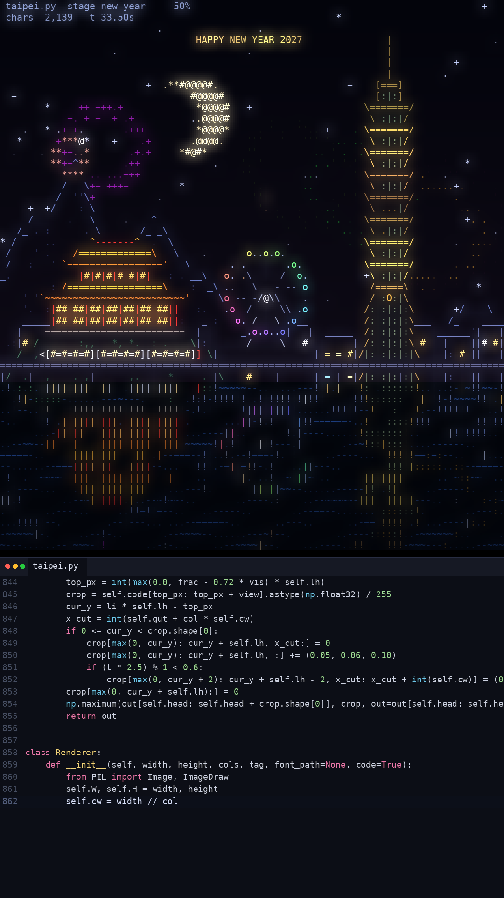

# ascii-taipei 🌃

A night view of Taipei drawn stage by stage with coloured ASCII characters, right in your terminal.

**Live demo:** https://baize404.github.io/ascii-taipei/

用彩色 ASCII 字元一筆一筆畫出台北夜景：觀音山、淡水河、圓山大飯店、摩天輪、捷運，最後 101 倒數、放跨年煙火。直接在終端機裡跑。



▶ [preview.mp4](preview.mp4)（39 秒，9:16，有配樂）

## 網頁版 / Web

直接打開上面的網址，或在本機用瀏覽器開 `index.html`。

- 手機、電腦都能看，畫面大小會自動調整
- 右下角「♪ 開聲音」播放配樂，聲音和畫面會對齊（煙火爆開的時候剛好有爆炸聲）
- 點一下畫面可以暫停／繼續

## 終端機版 / Terminal

```bash
pip install numpy
python taipei.py                    # Ctrl+C 結束
python taipei.py --at 24            # 直接從倒數開始看
python taipei.py --speed 1.5 --fps 24
python taipei.py --256              # 不支援 24-bit 色彩的終端機
```

需要支援 24-bit 色彩的終端機（Windows Terminal、VS Code、iTerm2、macOS Terminal 都可以）。視窗至少 120×40，字體調小一點效果最好。

## 錄成影片 / Record a video

```bash
pip install numpy pillow            # 另外需要 ffmpeg
python taipei.py --record taipei.mp4 --tag @yourname
python taipei.py --record still.png --at 33     # 只存一張圖
```

預設輸出 1080×1920 的直式影片，整個畫面都是夜景，配上自動產生的配樂。其他選項：

- `--no-music`：不要配樂
- `--record music.wav`：只輸出配樂
- `--code`：畫面下方加一個編輯器，把 `taipei.py` 一行一行打出來
- `--no-hud`：拿掉左上角的階段和時間（終端機版也能用）
- `--size 1920x1080 --cols 160`：改成橫式

## 動畫流程 / Timeline

整段 39 秒，會一直循環。

| 秒 | 階段 |
| --- | --- |
| 0–3 | 星空出現，月亮從山後升起 |
| 1.5–5 | 觀音山從左邊畫過來 |
| 4–7 | 淡水河 |
| 6–11 | 市區大樓往上長，摩天輪轉起來 |
| 10–13.5 | 圓山大飯店：紅柱子、金色雙層屋頂 |
| 13–18 | 台北 101 從底座一節一節蓋上去 |
| 18–21.5 | 窗戶亮燈，101 由下往上亮成彩虹色 |
| 21.5–24 | 捷運高架橋和列車，劃過一顆流星 |
| 24–29 | 101 外牆倒數 5、4、3、2、1 |
| 29–36.5 | 101 兩側噴出煙火，滿天煙火，打出 HAPPY NEW YEAR |
| 37–39 | 淡出，重新開始 |

## 原理 / How it works

1. 場景依終端機大小先建成好幾層：山、大樓、窗戶、飯店、101、高架橋。每一格存一個字元、一個顏色和一個「出現順序」（0 到 1）。
2. 時間軸把整段分成幾個階段。階段進度到 p 時，只顯示順序 ≤ p 的格子，所以山會從左往右掃過來、大樓往上長、101 一層一層蓋。剛出現的格子會先閃一下白光，像筆尖在畫。
3. 星星、月亮、摩天輪、捷運、流星和煙火每一幀重新計算。最後河面把上方亮著的東西鏡射下來，再用波浪打散成 `|` `!` `:`。
4. 每一幀用 24-bit ANSI 色碼輸出。錄影模式則把每個字元貼成圖片，加上光暈，再交給 ffmpeg 編碼。
5. `index.html` 是同一套邏輯的 JavaScript 版本，用 canvas 一格一格畫字。

## 配樂 / Music

配樂是 `taipei.py` 用 numpy 從零合成的原創音樂，沒有用到任何現成的音源或歌曲，可以放心拿去發影片。`music.m4a` 就是它輸出的檔案，網頁版用的也是這一份。

- 走溫馨路線：每分鐘 60 拍，用柔和的鋼琴、音樂盒和弦樂，沒有鼓，只有輕輕的心跳聲和沙鈴
- 和弦是 D 大調的 I–V–vi–iii–IV–I–IV–V（卡農的和弦進行），每兩秒換一個
- 跟著畫面走：星星出現時音樂盒一顆一顆響；圓山大飯店出現時有一聲低音；101 每蓋一節，音樂盒就往上升一個音；亮燈時一串豎琴滑音，鋼琴彈出卡農的 F#–E–D–C#
- 倒數時每一秒一聲音樂盒和一下心跳，音越來越高，弦樂慢慢漲上來；12 點整鋼琴彈出主旋律，最後一個和弦往上散開
- 煙火聲刻意做得像隔著河遠遠聽到的低沉悶響和劈啪聲，對準每一發煙火爆開的時間，左右聲道也照煙火在畫面上的位置擺放

Inspired by an ASCII-art reel on Instagram; this is an independent implementation.
